

    
    
    <a href="https://www.linkedin.com/in/nikhilsunchu"></a><a href="https://codeforces.com/profile/Nikhilsunchu11"></a>
    
    
    
        <a href="https://github.com/Nikhilsunchu1107/Recursion_7.0"></a><a href="https://github.com/Nikhilsunchu1107/MLDL_miniproject"></a>
        <a href="https://github.com/Nikhilsunchu1107/ecommerce_intelligence"></a><a href="https://github.com/Nikhilsunchu1107/Digital_twin"></a>
    
    

